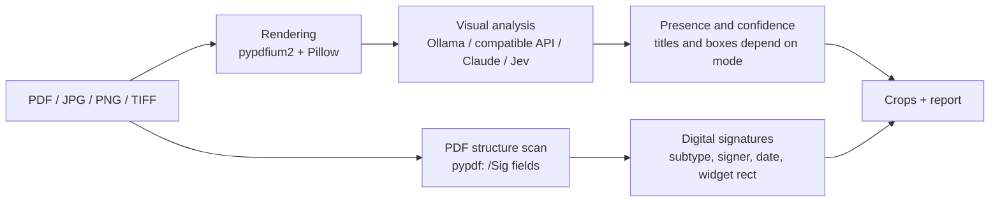

# Signum — AI document classification, organization and signature detection

[](https://www.python.org/)
[](https://doc.qt.io/qtforpython-6/)
[](https://mypy-lang.org/)
[](https://docs.astral.sh/ruff/)
[](LICENSE)

**Signum is a Windows desktop application for classifying PDFs, organizing them
into folders, and finding signatures in PDFs and scans.** Use local AI through
Ollama, Jev or JevK5, or connect a supported remote API. Choose your models,
edit classification categories and prompts, compare results, and review decisions
before organizing files.

[Download the Windows installer](installer/output/Signum-Setup-1.1.9.exe) ·
[Instrukcja po polsku](docs/INSTRUKCJA.pl.md) · [Changelog](CHANGELOG.md)

## What you can do

| Workspace | Main capabilities | Outputs |
|---|---|---|
| **Document classification** — Kategoryzowanie dokumentów | Define 2–12 categories; assign up to three labels per PDF; compare selected models on the same text; review and correct labels; copy or move files into category folders. | Persistent collection, operation log, CSV and JSON. |
| **Signature detection** — Sprawdzanie podpisów | Find handwritten signatures, initials and stamps; inspect digital signature fields; compare Ollama and Jev on the same queue; inspect source documents and available crops. | Results for each run, self-contained HTML and CSV comparison reports. |

### Your models, categories and instructions

- **Choose the backend.** Add and duplicate classification model configurations
  with your own API URL, model and key, or use a prepared local JevK5 runtime.
  Supported API formats are Chat Completions, Messages and Decisions.
- **Define the task.** Edit category names, descriptions and the classification
  prompt. Signature analysis has separate prompts for generative vision models
  and Jev's decision instructions. Settings for the two workspaces are independent.
- **Choose the depth of signature analysis.** Ollama can check presence only or
  generate descriptions and crops. Jev has an optional experimental extension
  for document categories and approximate crops.
- **Compare before choosing.** Classification supports selected configurations
  and 1–10 passes on identical prepared text. Signature analysis can run Ollama
  and Jev sequentially and show their decisions side by side. Timings distinguish
  preparation, local loading, model processing and total time.
- **Keep control of the result.** Open source PDFs directly, inspect all category
  scores, correct labels and preview destination paths before copying or moving.

### Document classification and organization

Add PDFs or folders, sample up to 100 PDFs from a folder, or open a locally saved
benchmark protocol. Classification reads the **PDF text layer, without OCR**.
It uses the beginning of the document (up to 12,000 characters), shortened to a
shared input budget for the selected models. Image-only scans need a text layer
before they can be classified in this workspace.

Signum keeps all category scores and selects up to three labels above the model's
threshold. **HITL (human-in-the-loop)** flags decisions for review, including
borderline rejected labels when fewer than three labels were selected.
Bundled profiles apply to the matching model, default prompt and category set:

| Classification model | Label threshold | HITL margin | Score source |
|---|---|---|---|
| Jev through Venice | 0.74 | ±0.03 | Decision-model scores |
| Local JevK5 | 0.83 | ±0.03 | Decision-model scores |
| Gemma `gemma4:12b` | 0.65 | ±0.05 | Model-declared confidence |

Scores are not guarantees of correctness. A custom model, prompt or category
definition without a matching calibration profile requires review in default mode.
To tune it yourself, enable **Własne progi** in that configuration's **Ustawienia AI**
and set **Próg decyzji (0–1)** and **Margines HITL (±)**. **Domyślne progi** restores
automatic profile selection. Explicit custom values apply even to custom categories
and prompts; they are recorded as user-defined, not measured calibration. Use
**Sprawdź etykiety…** to inspect scores and confirm or correct up to three labels.
Collections and human corrections are saved automatically between sessions;
the saved collection contains file references and results, not extracted PDF text.

**Skopiuj do folderów…** and **Przenieś do folderów…** organize selected documents
using the labels from a chosen model/pass. Review the destination plan first:

- Copies can go to every assigned category; moving requires one destination category.
- Existing files are never overwritten; duplicate names receive numbered suffixes.
- Files with errors, unresolved HITL or no assigned labels are skipped.
- Moves verify the copied bytes before deleting the source and update paths in
  both workspaces and reports. An operation log records the changes.
- Cancellation keeps completed operations and leaves the remaining sources in place.

### Signature detection and comparison

Add PDFs or images (JPG, PNG, TIFF, BMP or WebP) and run a selected provider,
or use **Porównaj Ollama + Jev** to compare both on the same queue.
Signum combines visual analysis with an independent scan of PDF signature fields.

| Analysis mode | What it returns |
|---|---|
| Generative vision model; Ollama with **Dodatkowa analiza** enabled | Short document title, visible signatures/initials/stamps, confidence and approximate boxes used for crops. |
| Ollama with **Dodatkowa analiza** disabled | Signature/initial and stamp presence, without generated titles or visual crops. |
| Basic Jev / `vjev-vision` | Signature/initial presence probability and separate stamp findings, using five views of each page; no signature counting or visual crops. |
| Jev with **Dodatkowa analiza** enabled | The same basic presence decision, plus up to two of 48 document categories and experimental approximate crops. |
| PDF structure scan, independent of the AI provider | Digital signature fields and subtypes, available signer/date metadata and visible widget crops. |

Signature runs remain available until the queue is cleared or the app closes.
HTML reports include model timings, side-by-side document decisions, and available
crops with page thumbnails showing the detected regions. CSV includes all runs,
agreement, errors and HITL. Partial or failed analysis remains visible in the results.

> Signum detects indications of signature **presence**. It does not validate
> identity, authenticity, certificates, document integrity or legal validity.

### TODO — improve signature localization

- [ ] Improve the spatial localization of signatures by **Gemma and
  `vjev-vision`**, especially in documents containing multiple signatures.
  Current bounding boxes and crops are not reliable enough: they can miss
  signatures, combine several signatures into one region or point to the wrong
  area. Work should cover tighter boxes, separation of individual signatures,
  and evaluation on documents with both single and multiple signatures.

This is a known limitation and remains open work. Detecting signature presence
does not guarantee its correct location or finding every signature. Review the
full source page rather than relying on a crop or report overlay alone. For vjev,
localization belongs to experimental **Dodatkowa analiza**; basic Jev does not
return visual crops or count signatures.

## How signature analysis works

Signature **Ustawienia AI** exposes decision thresholds and HITL margins for each
provider. Ollama has separate thresholds for presence-only and additional analysis;
Jev also exposes stamp, category, candidate-region, verification and single-signature
thresholds. **Domyślne progi** restores the values in the selected group.
All fields use a 0–1 scale. Generative vision modes filter reported confidence
(converted from 0–100); their default threshold and HITL margin are zero, preserving
the previous behavior. In these modes and basic Ollama, a zero margin disables
score-based HITL. For Jev and text classification, the HITL interval includes the
threshold itself even with a zero margin. Generative modes cannot score signatures
that the model did not report. PDF structural detections are independent of these settings.

Changes apply to new runs, including CLI runs using saved settings. Earlier results
retain their original decisions and thresholds. Adjusting a decision threshold does
not refit Jev's displayed probability calibration.



Two independent detection paths are combined per document:

1. **Visual path** — pages within the configured limit are rendered and passed
   to the selected model. Generative models return structured JSON; Jev answers
   typed decision questions. When a mode supplies bounding boxes, Signum validates
   them and creates crops from the full-resolution render.
2. **Structural path (PDF only)** — populated signature fields are inspected
   directly, including their signature data and `/SubFilter`. Supported structures
   include PAdES/CAdES, CMS/PKCS#7, X.509, RFC 3161 timestamps, certification
   signatures/DocMDP and usage-rights signatures. Empty placeholders are not
   positive detections. A confidence of 100 describes structural presence,
   not cryptographic validation.

Files are processed **sequentially** with a progress bar and ETA — memory usage stays flat
even for 1000-file batches. A per-file error never stops the batch; a lost AI connection
aborts it with a clear message.

## Models and AI providers

Jev for images and JevK5 for text have different roles and separate settings:

| Model / connection | Role in Signum | Where it runs |
|---|---|---|
| **Jev / `vjev-vision`** | Visual signature and stamp detection; optional experimental categories and crops. | Prepared local CUDA runtime or a compatible vjev API server. |
| **JevK5** | PDF text classification with independent category scores; reuses the document prefix across label questions. | Local PyTorch/CUDA worker. |
| **Jev through Venice** | PDF text classification through the Decisions API. | Remote service; see [setup details](docs/VENICE.pl.md). |
| **Ollama, including Gemma** | Text classification or signature analysis, depending on the selected model's capabilities. | Local Ollama or a configured remote server. |
| **Compatible APIs / Anthropic** | Text classification and, with an image-capable model, signature analysis. | Your configured service. |

Signature provider settings:

| Provider | Configuration | Notes |
|---|---|---|
| **Ollama** (default) | API URL + model picked from the installed list + optional API key | Tested with `gemma4:12b`. |
| **OpenAI-compatible API** | base URL + API key + model | Works with OpenAI, OpenRouter and any `/chat/completions`-compatible endpoint. |
| **Claude (Anthropic)** | base URL + API key + model | Messages API with base64 image blocks. Default URL: `https://api.anthropic.com/v1`. |
| **vjev-vision** | base URL + served model ID + optional API key + local runtime directory | Default: `http://localhost:8800/v1`, model ID `vjev-vision`. Uses [vjev-serve](https://github.com/BubbleCal/vjev-serve) `/systemone`. A prepared local CUDA runtime is started automatically during connection testing or analysis; remote API servers can also be used. |

Local runtimes live in the folder selected during setup. **Składniki AI** installs
Python, CUDA libraries and the chosen Jev or JevK5 model, or reuses an existing
installation after dependency and inference checks. `runtime.json` specifies the
absolute `python`, `packages`, and `model_dir` paths. Startup is offline and binds
only `127.0.0.1`; it does not download models. The settings button **Zatrzymaj lokalny
Jev / zwolnij GPU** stops only the server managed by Signum. Logs: `server.log`.
An unprepared runtime produces an actionable error instead of raw connection traces.
The GUI installer itself does not include the 9 GB model or CUDA libraries.
For local diagnostics, `Signum.exe --self-test-jev` tests the prepared default
localhost model from the packaged application and saves `packaged-self-test.json`
in the runtime directory; it does not read cloud settings or use cloud API keys.

Ollama and Jev have independent **Dodatkowa analiza** checkboxes. Ollama keeps
its existing description-and-crops mode enabled by default; disabling it requests
only signature and stamp presence. Jev keeps its frozen basic classifier by default;
the optional experimental extension adds up to two of 48 categories and approximate
crops using a 4 × 5 grid, adjacent-cell fusion and verification. The extension
preserves the basic presence decision. CLI equivalents are `--additional-analysis`
and `--no-additional-analysis`. See [the Polish guide](docs/INSTRUKCJA.pl.md).

Every provider has an editable API address, model field and protected API key field,
with *Pokaż*, *Wyczyść*, *Testuj połączenie* and *Zapisz*. Enter the **base URL**
(including `/v1` where shown), not the full inference route. Local processing is
recognized by the selected endpoint's loopback address (`localhost`, `127.0.0.1`, `::1`),
including vjev and compatible on-prem API servers. Remote endpoints require HTTPS.

Jev uses a separate editable default prompt, nine typed questions and five views
of each page: the full page and four overlapping quarters. The largest view score
at or above the configured threshold (**0.535** by default) indicates a visible
handwritten signature or initials.
The displayed probability uses calibration fitted on the experimental sample;
it is also shown for negative results and is not a guarantee for other documents.
Stamps are reported separately and do not make a document signed.
**Basic Jev does not count signatures or return signature crops.** Open the source
document from the results panel to verify it. Digital PDF signatures are still
scanned and cropped independently; Jev results retain the filename as their title.
The managed local Jev server releases GPU memory after an analysis batch.

*Testuj połączenie* for Jev checks the selected model and sends a small synthetic
image, which may incur API charges. A successful test validates transport and response
shape; it does not measure detection quality. Signature scores within the configured
HITL margin (default **±0.10** around **0.535**) are marked for review, including
negative decisions.
The transport follows the
[vjev API contract](https://github.com/BubbleCal/vjev-serve#the-api).

API keys are stored in the **Windows Credential Manager** (via `keyring`) — never in
config files. Settings live in `%APPDATA%\Signum\settings.json`.

Signature analysis requires an image-capable model; text classification does not.
Processing time and localization quality depend on the model, hardware, document
and analysis mode. The **Pomiary** panel and exported reports expose timings for
your runs. Model-reported boxes are approximate, so the HTML report pairs crops
with page thumbnails showing the detected regions.

Switching from a local endpoint to any remote endpoint triggers a warning dialog
(documents will leave your machine) with a 3-second hold on the confirm button,
and a red **"Model online"** badge stays visible while the selected configuration
is remote. Remote endpoints must use HTTPS. Starting a batch requires one explicit
risk acknowledgement for the entire queue — Signum does not interrupt the user
for every added document. Before that acknowledgement Signum performs a preflight
which verifies that the selected service and model are actually available.

## Installation

### Installer (recommended)

Signum is a demo project. Download [Signum-Setup-1.1.9.exe](installer/output/Signum-Setup-1.1.9.exe)
and its [SHA-256 checksum](installer/output/Signum-Setup-1.1.9.exe.sha256).
Run the installer to begin setup. Per-user install,
no administrator rights required. Polish and English installer languages. The
installer contains the Python runtime and application libraries, so a separate
Python installation is not required for Signum itself. The installer offers optional
third-party components and detects dedicated GPU memory through DXGI: Gemma 4 E2B
for an 8 GB GPU, Gemma 4 12B for 16 GB, and Jev (signatures) / JevK5 (text classification) for NVIDIA 16 GB.
These are conservative memory recommendations, not performance guarantees.
Choose the components and their storage folder; a progress window then downloads,
prepares and checks the selected AI, and configures Signum without terminal commands.
Existing running Ollama services and prepared Jev / JevK5 runtimes can be reused.
**Składniki AI** in either workflow provides checks, installation and repair, including
additional named Ollama models. Errors include recovery steps for libraries, drivers,
memory, disk space and API authentication. Without H:, storage defaults to the user's
Documents/SignumAI; the user can choose another drive. Model profiles are configured
after a successful inference test. The check-only action performs no downloads.
External components retain their own licences and remain after uninstalling Signum.
Downloads occur only for components selected by the user. The
installer includes a separate document-and-AI risk page with four required
acknowledgements covering its educational purpose, sample documents without
personal or sensitive data, local AI processing, and transfer to a remote provider.
See the [installer notice](installer/legal/RISK-NOTICE-en.txt). Silent installation
requires `/ACKNOWLEDGERISKS=1`.

### From source

```powershell
git clone <repository-url>
cd signum
python -m venv .venv
.venv\Scripts\python -m pip install --upgrade pip==26.1.2
.venv\Scripts\pip install --build-constraint constraints.txt -c constraints.txt -e .[dev]
.venv\Scripts\signum          # GUI
```

For local AI: install [Ollama](https://ollama.com) and pull a vision model:

```powershell
ollama pull gemma4:12b
```

## Usage

**Classify and organize:** open *Kategoryzowanie dokumentów* → add PDFs → edit
categories and instructions → choose a model in *Ustawienia AI* → *Kategoryzuj*
or *Porównaj modele* → confirm the batch notice → review labels → export CSV/JSON
or preview a copy/move into category folders.

**Check signatures:** open *Sprawdzanie podpisów* → choose the provider, model
and analysis mode in *Ustawienia AI* → add PDFs/images → *Przetwórz* or
*Porównaj Ollama + Jev* → confirm the batch notice → review source documents,
decisions and available crops → *Zapisz raport…* (HTML/CSV).

**CLI** (signature analysis in scripts / batch jobs):

```powershell
signum-cli C:\skany --html raport.html --csv raport.csv --acknowledge-risks
signum-cli umowa.pdf skan.jpg --provider ollama --model gemma4:12b --max-pages 5 --acknowledge-risks
```

Without `--acknowledge-risks`, CLI prints the complete risk notice and exits
without connecting to an AI service or processing documents.

Exit codes: `0` when the batch finishes without document errors, `1` when a
document fails or the batch is interrupted by a connection error, and `2` for
invalid arguments, missing input, missing risk acknowledgement, or failed preflight.
Reports are still written for batches containing document errors. A failed or
incomplete PDF structure scan is reported as an error, not as absence of signatures.

## Configuration

| Setting | Default | Meaning |
|---|---|---|
| `provider` | `ollama` | `ollama` / `openai` / `anthropic` / `vjev` |
| `ollama_url` | `http://localhost:11434` | Ollama endpoint |
| `ollama_model` | `gemma4:12b` | must be a vision model |
| `ollama_num_ctx` | `8192` | context window sent as `options.num_ctx` (Ollama's own default is only 4096) |
| `openai_base_url` | `https://api.openai.com/v1` | OpenAI-compatible API base URL |
| `anthropic_base_url` | `https://api.anthropic.com/v1` | Claude Messages API base URL |
| `vjev_base_url` | `http://localhost:8800/v1` | vjev-serve API base URL |
| `vjev_model` | `vjev-vision` | model ID advertised by `/v1/models` |
| `vjev_runtime_dir` | `H:/Tools/SignumJev` | prepared local CUDA runtime; used only for loopback auto-start |
| `max_pages_per_doc` | `10` | pages analyzed per document |
| `model_image_max_side` | `1120` px | page image size sent to the model |
| `custom_prompt` | `""` | user-edited task part of the prompt; empty = built-in (the JSON response format is always appended automatically) |
| `jev_custom_prompt` | `""` | vjev decision instructions; separate from the LLM prompt, without a generated JSON schema |
| `timeout_s` | `300` | per-request AI timeout |
| `recursive_folders` | `true` | recurse into subfolders |

## Development

```powershell
.venv\Scripts\pip install --build-constraint constraints.txt -c constraints.txt -e .[dev]
.venv\Scripts\python -m pytest            # no network needed
.venv\Scripts\python -m ruff check src tests scripts
.venv\Scripts\python -m mypy
.venv\Scripts\pip-audit
```

Test documents (including **genuinely digitally-signed PDFs** — pyhanko with a self-signed
certificate) are generated on the fly by `tests/docfactory.py`; no binary fixtures in the repo.

### Building the installer

Requires [Inno Setup 6](https://jrsoftware.org/isinfo.php).

```powershell
powershell -ExecutionPolicy Bypass -File scripts\build_installer.ps1
# → installer\output\Signum-Setup-<version>.exe
```

The build script runs a self-test of the packaged executable before invoking
Inno Setup. This verifies the bundled Python runtime, required libraries and UI
resources rather than merely checking that an `.exe` file exists. It also prints
and saves the SHA-256 digest next to the installer.
The current installer and its checksum are tracked in Git. Research reports,
corpora, example documents, local notes and other build outputs are excluded.

### Project structure

```
src/signum/
├── app.py            # GUI entry point
├── cli.py            # headless batch mode (signum-cli)
├── config.py         # settings JSON + API keys in Credential Manager
├── ai/               # vision and text clients, Jev/JevK5 workers,
│                     # local runtimes, prompts and response parsers
├── core/             # classification, calibration, collection persistence,
│                     # folder filing, rendering and signature detection
├── setup_local_ai.py # optional AI component installation and checks
├── report/           # signature reports and model comparisons (HTML/CSV)
└── ui/               # both workspaces, model/settings/component dialogs,
                      # label review, filing preview and worker threads
```

Design notes live in [docs/ARCHITECTURE.md](docs/ARCHITECTURE.md);
a Polish user guide in [docs/INSTRUKCJA.pl.md](docs/INSTRUKCJA.pl.md).

## Privacy & limitations

- With an AI API at a loopback address, documents are processed locally, but their
  contents are still passed to an AI model. A LAN or Internet API endpoint is
  remote and is labelled as such. Local execution alone does not determine whether
  the processing is authorized or appropriate.
- With remote providers, extracted text (classification) or page images
  (signature analysis) are sent to the provider's API — check your
  organization's policy before use. Signum makes this explicit: a countdown
  warning when switching away from the local provider and a persistent
  "Model online" badge in the status bar.
- Visual detection and text classification are probabilistic. Scores, source
  documents and available crops support human review. Digital-signature detection
  inspects PDF structure, but Signum
  **does not** validate certificates, revocation or document integrity.
- The user is responsible for authorization to process the selected documents,
  applicable organizational and confidentiality requirements, and verifying that
  results are fit for the intended purpose. A Signum result must not be the sole
  basis for a legal, business, or organizational decision.
- Signature HTML reports contain available crops and page thumbnails; signature
  CSV/HTML use file names rather than full local paths. Classification CSV/JSON
  and saved collections include file paths and results, but not extracted PDF
  text or API keys. Review exports before sharing.
- Encrypted PDFs that require a password are reported as errors (structure scan is skipped).
- Test PDFs, benchmark corpora and research reports remain local and are excluded
  from the repository and installer. Git ignores PDF inputs; CI and installer
  builds check delivery inputs with `scripts/check_local_documents.py`.

## License

[MIT](LICENSE)
